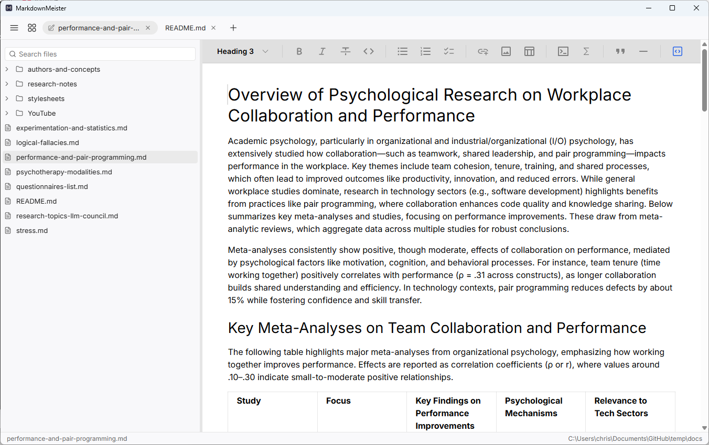

<p>
  
</p>

# MarkdownMeister

A free markdown editor for Windows, macOS and Linux. Write with a live preview or the raw source, browse a folder in the sidebar, and keep several documents open in tabs. Your files stay plain markdown on disk.

[Project site](https://yetanotherchris.github.io/markdownmeister/) · [Releases](https://github.com/yetanotherchris/markdownmeister/releases/latest) · [Issues](https://github.com/yetanotherchris/markdownmeister/issues)



## Install

### Windows (Scoop)

```sh
scoop bucket add markdownmeister https://github.com/yetanotherchris/markdownmeister
scoop install markdownmeister
```

### macOS and Linux (Homebrew)

```sh
brew tap markdownmeister https://github.com/yetanotherchris/markdownmeister
brew install markdownmeister
```

### macOS (Direct Download)

Download the matching macOS DMG or ZIP from [Releases](https://github.com/yetanotherchris/markdownmeister/releases/latest). Each macOS build is signed with a Developer ID certificate and notarized by Apple, so it opens normally with Gatekeeper enabled.

### Windows (Microsoft Store)

Search for **MarkdownMeister** in the Microsoft Store, or open the [Store search page](https://apps.microsoft.com/search?query=MarkdownMeister). Installing from the Store carries Microsoft's own signing, so there is no developer-certificate or SmartScreen warning.

### Linux (Snap Store)

Available on the [Snap Store](https://snapcraft.io/markdownmeister) and installs with:

```sh
sudo snap install markdownmeister
```

### Linux (Debian, Ubuntu, Mint)

Download `markdownmeister_<version>_amd64.deb` from [Releases](https://github.com/yetanotherchris/markdownmeister/releases/latest). The package is for x86-64 (amd64) systems running Ubuntu, Linux Mint, Debian, Pop!_OS, or their derivatives. Open the downloaded file in your graphical software installer, or install it from a terminal (replace `<version>` with the downloaded version):

```sh
sudo apt install ./markdownmeister_<version>_amd64.deb
```

To update, download the newer `.deb` and install it the same way. This does not add an apt repository or automatic updates. To uninstall:

```sh
sudo apt remove markdownmeister
```

For other Linux distributions, use the AppImage from Releases.

## Technology

- Milkdown for the WYSIWYG editor, CodeMirror for the source view.
- Electron and TypeScript.
- Built spec-first with [Spec Kit](https://github.com/github/spec-kit): the specification is the source of truth, and code follows it.
- Developed with DeepSeek, Claude, GPT, and GLM.

## Learn more

Features, keyboard shortcuts, settings, and folder actions are documented on the [project site](https://yetanotherchris.github.io/markdownmeister/). MarkdownMeister is free and open source under the [MIT licence](LICENSE).
